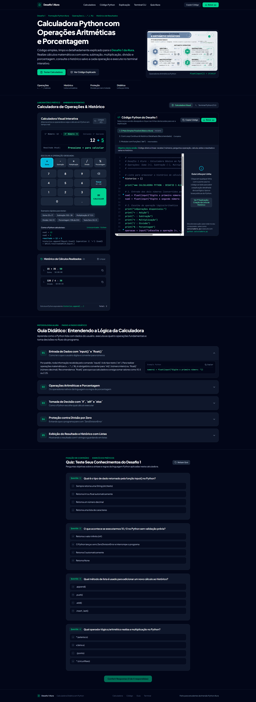

<div align="center">

# 🧮 Calculadora Python — Imersão Alura

[](https://www.alura.com.br/)
[](https://react.dev/)
[](https://www.typescriptlang.org/)
[](https://vitejs.dev/)
[](https://tailwindcss.com/)
[](https://www.python.org/)

<p align="center">
  Laboratório didático e interativo desenvolvido para o <strong>Desafio 1 da Imersão de Engenharia de Software com IA da Alura</strong>.
  O projeto une o aprendizado da lógica de programação em <strong>Python</strong> a uma <strong>aplicação Web moderna</strong> para visualização e testes em tempo real.
</p>

---

### 🖥️ Demonstração do Layout da Aplicação



</div>

---

## 📍 Onde foi feito?

Este projeto foi construído durante a **Imersão de Engenharia de Software com IA**, promovida pela [Alura](https://www.alura.com.br/).

O desenvolvimento foi realizado em ambiente local assistido por **Inteligência Artificial (Pair Programming)**, aplicando boas práticas de engenharia de software: versionamento semântico com Git, componentização desacoplada, tipagem estática e testes de segurança para erros matemáticos clássicos (como `ZeroDivisionError`).

---

## ⚙️ Como foi feito?

A aplicação foi estruturada em duas camadas integradas que se complementam pedagogicamente:

### 1. Núcleo Algorítmico em Python
A lógica fundamental foi concebida para quem está dando os primeiros passos na programação, cobrindo as 5 operações essenciais:
* **Adição (`+`)**, **Subtração (`-`)**, **Multiplicação (`*`)**, **Divisão (`/`)** e **Porcentagem (`%`)**.

O código foi construído em **3 versões evolutivas**:
1. **Versão 1 — Básico / Linear:** Execução direta com captura via `input()`, conversão de tipos com `float()`, tomada de decisão com `if / elif / else`, prevenção ativa de divisão por zero e acúmulo em lista via `.append()`.
2. **Versão 2 — Loop Contínuo & Histórico:** Execução interativa dentro de `while True`, com tratamento de exceções amigável (`try / except ValueError`) e menu de controle (`[H]` para ver histórico e `[S]` para sair).
3. **Versão 3 — Modular com Funções (`def`):** Organização profissional com responsabilidades isoladas (`somar`, `subtrair`, `multiplicar`, `dividir`, `porcentagem` e `registrar_calculo`).

> 💡 **Nota sobre Porcentagem:** No Python nativo, `%` calcula o resto da divisão inteira (módulo). Na calculadora, implementamos a regra de negócio matemática para taxa percentual: `(valor * taxa) / 100`.

---

### 2. Plataforma Web Educacional
Para tornar a experiência tangível e interativa, o projeto conta com uma interface Web completa construída com tecnologias de ponta do ecossistema front-end:

* **React 19 & TypeScript:** Componentes desacoplados, reativos e fortemente tipados (`OperationType`, `CalculationRecord`).
* **Vite:** Servidor de desenvolvimento ultrarrápido com Hot Module Replacement (HMR).
* **Tailwind CSS v4:** Design moderno em *dark mode*, com hierarquia visual clara, feedback de erros em vermelho e destaques de sucesso em esmeralda.
* **Lucide React:** Iconografia funcional para ações de teclado, histórico, cópia e limpeza.

---

## ✨ Funcionalidades

- [x] **Calculadora Visual Interativa:** Permite alternar os operandos, clicar nos botões ou usar o teclado físico (incluindo atalhos `Enter`, `Esc`, `Backspace`).
- [x] **Terminal Python (CLI) no Navegador:** Simulador interativo que reproduz a linha de comando do terminal com prompts de entrada e saída formatada.
- [x] **Exibição do Código em Tempo Real:** Mostra a linha exata de código Python equivalente ao cálculo que está sendo realizado na tela.
- [x] **Histórico de Cálculos:** Lista detalhada com data/hora, expressão matemática, resultado e botão de copiar com 1 clique.
- [x] **Tratamento de Exceções:** Bloqueia divisões por zero com alerta visual amigável sem interromper a execução da aplicação.
- [x] **Exemplos Rápidos (Presets):** Atalhos para testar rapidamente cada operação aritmética e a porcentagem.
- [x] **Guia de Conceitos & Quiz:** Seção teórica para revisar conceitos de tipos, variáveis, listas e operadores com perguntas para autoavaliação.

---

## 📁 Estrutura de Arquivos

```text
Imers-o-Alura/
├── index.html                    # Página HTML de entrada
├── package.json                  # Dependências e scripts do projeto
├── vite.config.ts                # Configuração do Vite
├── Desafio1Alura.png             # Demonstração visual do layout
├── README.md                     # Documentação completa
└── src/
    ├── main.tsx                  # Ponto de inicialização do React
    ├── App.tsx                   # Componente raiz e gerenciador de estado
    ├── index.css                 # Estilos globais e Tailwind CSS
    ├── types/
    │   └── calculator.ts         # Tipos e interfaces TypeScript
    ├── data/
    │   └── pythonCode.ts         # Códigos Python comentados, guia e quiz
    └── components/
        ├── VisualCalculator.tsx  # Calculadora com teclado numérico e botões
        ├── PythonTerminal.tsx    # Simulador do terminal de linha de comando
        ├── HistoryList.tsx       # Lista com histórico de contas realizadas
        ├── CodeViewer.tsx        # Visualizador de código com anotações didáticas
        ├── ConceptGuide.tsx      # Guia teórico dos conceitos de Python
        ├── QuizSection.tsx       # Quiz interativo para fixação
        ├── Header.tsx            # Barra superior de navegação
        ├── Hero.tsx              # Apresentação do Desafio 1 da Alura
        └── Footer.tsx            # Rodapé informativo
```

---

## 🚀 Como Executar o Projeto Localmente

### Pré-requisitos
* [Node.js](https://nodejs.org/) (versão 18 ou superior recomendada)
* Git instalado

### Passo a Passo

1. **Clone este repositório:**
   ```bash
   git clone https://github.com/Berghahn/Imers-o-Alura.git
   cd Imers-o-Alura
   ```

2. **Instale as dependências:**
   ```bash
   npm install --legacy-peer-deps
   ```

3. **Inicie o servidor de desenvolvimento:**
   ```bash
   npm run dev
   ```

4. **Acesse no seu navegador:**
   Abra [http://localhost:3000](http://localhost:3000) para interagir com a aplicação.

5. **Para gerar a versão de produção (Build):**
   ```bash
   npm run build
   ```

---

## 👨‍💻 Autor

Projeto desenvolvido por **Berghahn** para os desafios da **Imersão de Engenharia de Software com IA** da [Alura](https://www.alura.com.br/).
